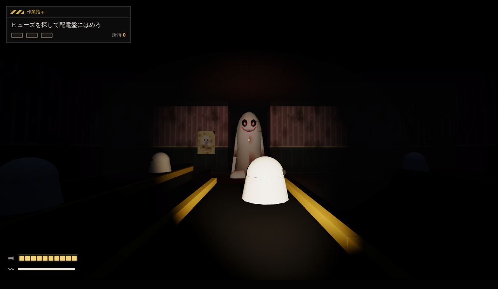
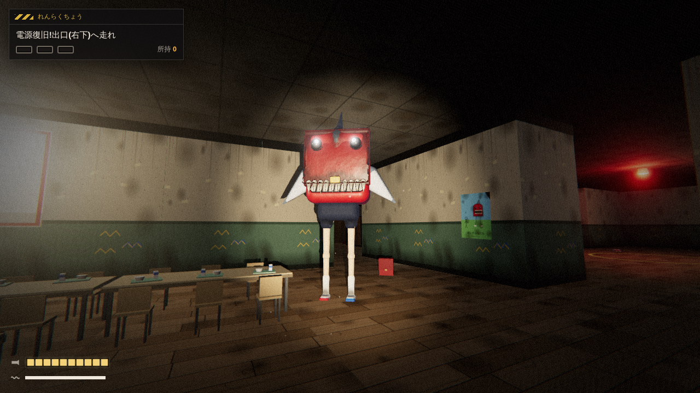
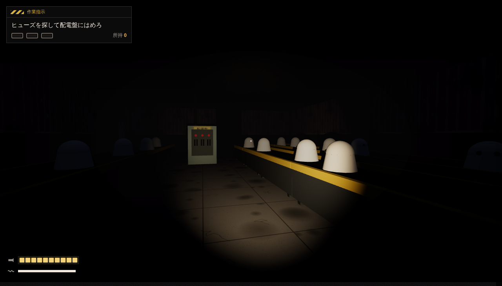
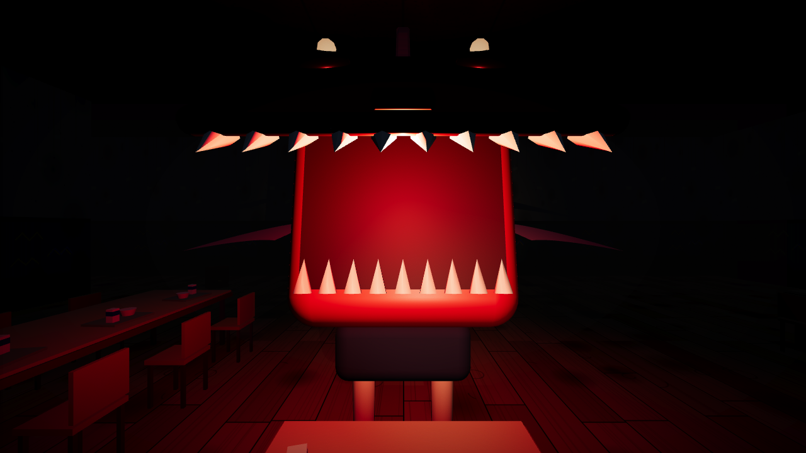
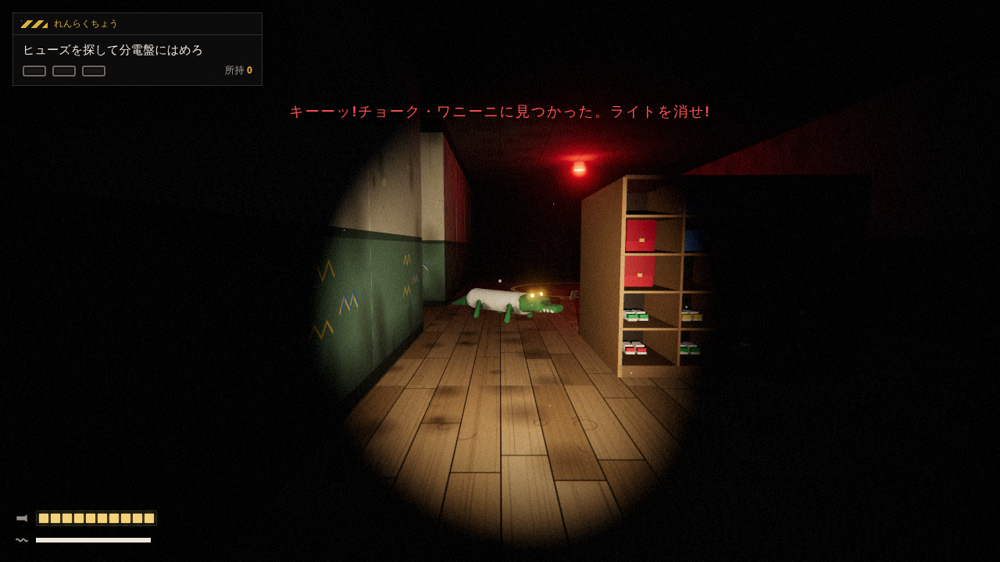
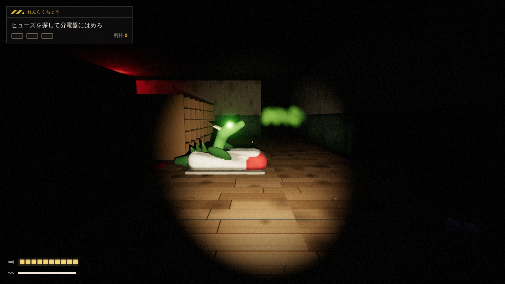

# おばけポン 3D

夜の小学校を舞台にした、ブラウザで遊ぶ一人称ホラーゲームです。ブレインロット風の怪物「ランドセルザメ・ガブガブーノ」から逃げながら、ヒューズを3本集めて電源を戻し、校舎から脱出します。

Poppy Playtime のような一人称ホラーに、「持ち物 + 動物」を合体させたブレインロット風のキャラクターを組み合わせ、バカバカしいのに怖い雰囲気を目指しています。キャラクター、名称、デザインはすべてオリジナルです。



| ガブガブーノ(SDF スカルプト) | ペンギーノ | 多目的ホール | ジャンプスケア |
|---|---|---|---|
|  |  |  |  |

| チョーク・ワニーニ(光に反応) | うわばき・ドラゴンチーノ(音に反応) |
|---|---|
|  |  |

作り方の背景(2026年のバイブコーディング事例の調査)は [artifacts/vibe-research.md](artifacts/vibe-research.md) にまとめています。

## キャラクター

| 名前 | 説明 |
|---|---|
| **ランドセルザメ・ガブガブーノ** | 身長約4mの赤いランドセル。かぶせ(フタ)がサメのアゴで、開くとギザギザの歯が並ぶ。背びれ、胸びれ、尾びれがあり、白い靴下と上履きを履いた細長い足で歩く。名札は「6ねん2くみ」。追ってくるときは「ガブガブ」とアゴを鳴らす |
| **ぎゅうにゅうパック・ペンギーノ** | 牛乳パックの体のペンギン(身長約2m)。図書室で、見ていないときだけ首を回す |
| **チョーク・ワニーニ** | チョークの体のワニ。1階廊下を巡回する見張りで、**ライト**に反応する。点けたまま視界に入ると、黒板をひっかくような声で鳴いてガブガブーノを呼ぶ |
| **うわばき・ドラゴンチーノ** | 上履きの体の竜。理科準備室の入口で眠っていて、**音**に反応する。いびきが聞こえたら要注意で、近くで走ると起きて吠え、ガブガブーノを呼ぶ。そっと歩けば起きない |

## 遊び方

```bash
cd game
npm install
npm run dev
# → http://127.0.0.1:5188 をブラウザで開く
```

| 操作 | キー |
|---|---|
| 移動 | `W` `A` `S` `D` |
| 見回す | マウス(画面クリックでマウスを固定)/ `←` `→` |
| 走る | `Shift`(スタミナを消費) |
| 懐中電灯 | `F` / 右クリック |
| 拾う・はめる | `E` |
| 一時停止 | `Esc` |

ヘッドホン推奨です。大きな音とびっくりする演出があります。

## 機能(チャプター1「よふけの ポンポン小学校」)

- **目的**: 校舎に散らばったヒューズを3本集め、多目的ホールの分電盤にはめる。電源が戻ると昇降口の出口が開く。
- **ガブガブーノのAI**: 徘徊 → 警戒 → 追跡 → 捜索の状態機械で動く。視界は扇形で、壁や棚で遮られる。足音も聞き取る。経路探索はA*。
  - 目の色で状態がわかる(白 = 徘徊、黄 = 警戒、赤 = 追跡)。
  - ヒューズを拾うほど速く、しつこくなる。電源復旧後は常にプレイヤーを追う。
- **懐中電灯**: 点けると周りが見えるが、遠くから見つかりやすい。ガブガブーノに当てると動きが鈍るが、電池を早く消費する。
- **非常灯の下(安全地帯)**: ガブガブーノに見つからず、電池とスタミナが回復する。
- **ジャンプスケアと再開**: 捕まるとアゴが開いて迫ってくる演出のあと、チェックポイント(入口、または分電盤の前)から再開する。
- **音**: Web Audio だけで手続き的に生成する。開始時と遠くで歪んで鳴る学校のチャイム、方向がわかる足音と噛みつき音(HRTF)、近づくと速くなる心拍、低いドローン音、叫び声など。
- **ビジュアル(すべてバイブ生成。外部の画像や3Dモデルは0)**
  - **SDF スカルプト**: ガブガブーノとペンギーノは、距離関数をなめらかに合成して彫り、Surface Nets でメッシュ化している(`src/render/sdf.ts`)。
  - **SDF の陰影と質感**: AO を頂点に焼き込み、FBM のシワを足し、シェーダで革のシボとリムライトを付ける(`src/render/sdf.ts`、`src/render/surfaceDetail.ts`)。
  - **ポストエフェクト**: ブルーム(目や非常灯)、危険度で強まる色収差と赤い脈動、周辺減光、フィルムグレイン(`src/render/PostFX.ts`)。
  - **懐中電灯の光の筋と、光の中に浮かぶチリ**: シェーダのみで描く(`src/render/FlashlightBeam.ts`)。
  - **校舎**: 壁、木の床、掲示物、黒板、下駄箱とランドセル、長机と給食。Canvas とジオメトリの合成で作る。
- **ぎゅうにゅうパック・ペンギーノ**: 図書室の奥に立っている。プレイヤーが目をそらしている間だけ、こちらへ向き直る。
- **ステルスの判断**: ライトを使うか(ワニーニ)、走るか(ドラゴンチーノ)を、仲間の配置を見て選ぶ。見つかると、ガブガブーノが小走りで駆けつける。

## 技術仕様

| 項目 | 内容 |
|---|---|
| 構成 | Vite 8 + TypeScript + Three.js r184 |
| マップ | 26×20マスのグリッド(1マス3m)。`game/src/world/levelData.ts` の文字列で定義 |
| 当たり判定 | マスごとの矩形と円の押し出し(物理エンジンなし) |
| 敵AI | `game/src/entities/Monster.ts`(状態機械 + A* + 視線判定)。見た目は `GabugabunoModel.ts` |
| ライティング | 懐中電灯のスポットライト(影あり)、非常灯、電源復旧で点く天井灯、指数フォグ |
| 乱数 | シード付きRNG(`utils/random.ts`)。テストを再現可能にするため、ゲームプレイの乱数はすべてここを通す |
| 3Dモデル | SDF スカルプト + Surface Nets(`src/render/sdf.ts`)。起動時に生成する |
| 描画 | WebGL + EffectComposer(MSAA×4 → UnrealBloom → Output → ホラー仕上げシェーダ) |
| テスト用フック | `window.__THREE_GAME_TEST_HOOKS__`(状態: `title` / `active-play` / `chase` / `showcase` / `penguino` / `wanini` / `dragontino` / `jumpscare` / `caught` / `finale` / `complete`)と `window.__THREE_GAME_DIAGNOSTICS__` |

### ディレクトリ

```
game/
  src/core/      ループ、レンダラー、入力
  src/render/    SDF スカルプト、ポストエフェクト、懐中電灯の光の筋
  src/world/     マップ定義、レベル生成、手続きテクスチャ
  src/entities/  プレイヤー、ガブガブーノ(AI とモデル)、ペンギーノ、ワニーニ、ドラゴンチーノ、ヒューズ
  src/systems/   音、HUD、デバッグ用パネル
  src/game/      ゲーム進行(Game.ts)
  tests/         Playwright(画面確認、ボットによるプレイテスト)
artifacts/       企画書、進行メモ、バイブコーディングの調査メモ(vibe-research.md)
.claude/skills/  ゲーム制作用の Claude Code スキル(threejs-game-skills、shader-dev、CloudAI-X/threejs-skills)
```

### 開発用コマンド

```bash
npm run build          # 型チェックと本番ビルド
npm run inspect:canvas # 各状態の画面をキャプチャして検査
npx playwright test tests/bot-playtest.spec.ts --project=desktop-chrome  # ボットのプレイテスト
```

`?debug` を付けて開くと、移動速度、マウス感度、懐中電灯の明るさを調整するパネルが出ます。

## 今後の予定

- 3D生成API(Tripo)でガブガブーノをリッチなモデルに差し替える
- ElevenLabs で「ガブガブーノ」の声と効果音を収録する
- ブレインロット仲間(ワニーニ、ペンギーノ、ドラゴンチーノ)を敵や味方として登場させる
- チャプター2以降、パズルギミック、スマホ対応
